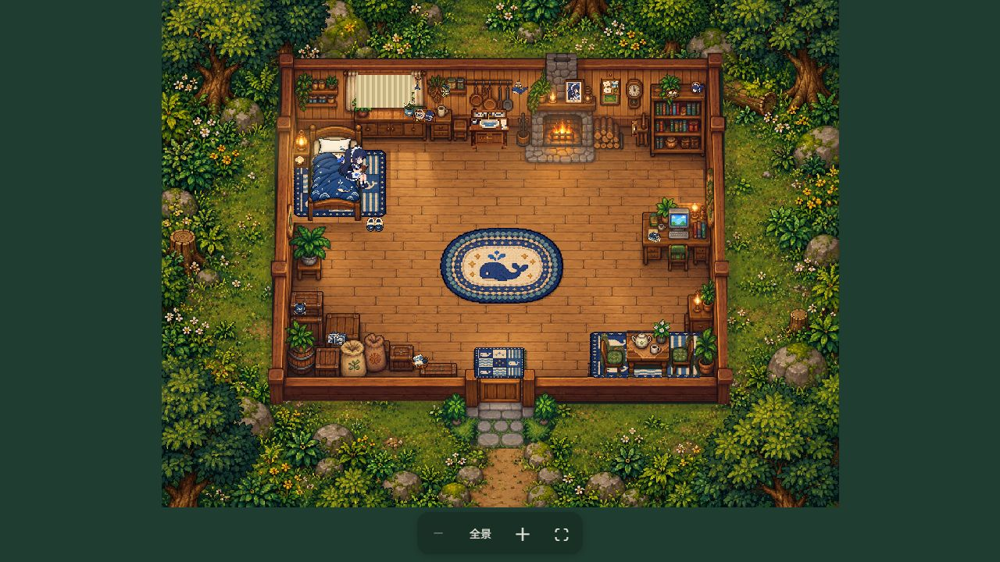

# 大肥鱼的小屋 · Preview

让原来的大肥鱼在像素小屋里生活。你继续在宿主聊天，她自主决定坐床沿、看手机、吃喝、读书、整理、烤火或睡觉；小屋窗口是可以拖动、缩放的观察画面。



**当前版本：`0.6.4-preview.1`，公开测试预览版。** [下载安装包](https://github.com/bearyluo/dsh-dafeiyu-room/releases) · [反馈问题](https://github.com/bearyluo/dsh-dafeiyu-room/issues)

## 可以做什么

- 主模型通过 `room_observe` 和 `room_plan` 安排屋内生活。本地引擎负责寻路、坐卧、家具遮挡、道具和持续动画。
- DSH 里有可拖动的小房子入口，展开为可移动、缩放的摄像头浮窗。
- 时间按配置时区同步；天气按用户选择的城市查询。庭院有昼夜、雨、雪和雾等表现。首次示例城市为北京。
- 原宿主的工作工具运行时，她会去电脑前；闹钟镜像原宿主投递到当前会话的定时任务。
- 安卓伴侣提供小屋预览和其他应用上方的浮窗。同一局域网连接，手机无需安装 DSH。
- 主会话离线或断线时显示床上睡姿，标记为“本地休息画面”；重连后恢复真实状态。这个显示不会改写模型计划。

第一版以屋内生活为范围；商店、种地、钓鱼和完整户外世界尚未实现。

## 兼容范围

宿主接口按 **DeepSeek Harness SDK `0.2.1-rc.5`** 开发，目标为 [QCYTSN/dsh-dafeiyu](https://github.com/QCYTSN/dsh-dafeiyu)。源码使用 Node.js **24.9 或以上**。CLI 的 npm 包入口为 `@deepseek-ai/dsh`（本版对应 `0.2.1-rc.5`），而不是 `@deepseek-ai/dsh-cli`。

插件沿用原主 Agent、原聊天、人格和记忆，通过独立的环境上下文和身体工具接入。它不配置第二个模型客户端。其他性格、记忆和思考插件可以共同安装，但**尚未逐一验证第三方分支**；保留相同服务接口与客户端插槽的分支才有接入基础。宿主的记忆总结插件仍可能记录小屋通知和工具调用。

安卓要求 **Android 8 / API 26 以上**，目标 API 35；系统悬浮权限、ROM 后台限制和横竖屏表现需要真机验收。iOS 没有本项目的跨应用浮窗，可使用手机网页。

## 电脑安装

1. 在 [Releases](https://github.com/bearyluo/dsh-dafeiyu-room/releases) 下载 `dsh-dafeiyu-room-0.6.4-preview.1.tgz`。它是宿主插件；APK 是手机伴侣，二者用途不同。
2. 使用宿主 CLI 安装到所用的 profile。以下以桌面端为例：

   ```powershell
   dsh plugin --profile desktop add "D:/Downloads/dsh-dafeiyu-room-0.6.4-preview.1.tgz"
   ```

   `dsh` 需为该宿主版本提供的 CLI；若不在 PATH，请使用宿主安装目录的命令入口。浏览器客户端使用对应的 `web` profile。
3. 通过宿主插件管理重载，或正常关闭后重新打开 DSH。进入原聊天，小房子入口会出现在页面上。

城市与时区在 DSH 插件设置里修改。天气来自 [Open-Meteo](https://open-meteo.com/)，数据按 [CC BY 4.0](https://creativecommons.org/licenses/by/4.0/) 署名使用；默认免费 API 适用于其[非商业服务条款](https://open-meteo.com/en/terms)，商业部署需自行配置符合服务条款的方案。空闲生活默认：用户消息后空闲 2 分钟、两次决策至少相隔 10 分钟、每天最多 12 次自主唤醒；睡眠计划未结束时不会被日常通知唤醒。一次唤醒可能包含多个模型步骤。

## 安卓浮窗：同一 Wi-Fi

1. 为宿主插件配置本机观察端口 `viewerPort: 8796`。保留宿主原有配置结构，在此插件的 `config` 中加入该项并重载。可参考 [配置示例](docs/configuration.md)。
2. 在电脑准备一个独立目录，安装下载的插件包，再启动只读中继：

   ```powershell
   mkdir cabin-viewer
   cd cabin-viewer
   npm init -y
   npm install --ignore-scripts "D:/Downloads/dsh-dafeiyu-room-0.6.4-preview.1.tgz"
   npx --no-install dsh-room-viewer --lan --apk "D:/Downloads/dafeiyu-room-android-0.6.4-preview.1.apk"
   ```

3. 手机与电脑连接同一 Wi-Fi，打开终端打印的**完整连接**。下载安装 APK，再回到网页点“打开安卓悬浮窗”。在应用内保存连接、允许悬浮权限，点击“开启悬浮小屋”。

首次配对后保存在应用私有存储，后续直接打开应用即可。拖动小房子移动，点一下展开；拖动画面移动浮窗，右下角缩放，右上角放大或收起。通知栏或应用内可关闭。

电脑、DSH 和中继服务需要保持运行才能同步。安装页能打开但人物离线时，先检查 DSH 的原会话与本机 `8796` 观察端口。多网卡可用 `--host` 指定本机私有 IPv4。

**完整连接包含只读凭证，请勿贴到公开 Issue。** 普通 HTTP 只适合可信局域网；应用只接受字面 RFC1918 私有 IPv4 的 HTTP，以及有效 HTTPS 配对。没有自动开启的公网入口。故障处理见 [连接说明](docs/configuration.md)。

## Token 与数据

看画面、播放动画、离线睡姿和天气轮询不调用模型。额外模型用量来自环境说明、状态、两个工具，以及空闲自主决策。

按 DeepSeek 官方 V4 分词器对合成状态离线测算，普通工具模式下约增加 **1,500 输入 Token / 模型请求**。原输入为 5,000 / 10,000 / 20,000 Token 时，对应约 30% / 15% / 7.5% 输入增幅。它不是全天总费用增幅：自主唤醒会携带宿主上下文、工具回合可能继续请求，缓存和输出也影响费用。详见 [测算方法](docs/token-cost.md)。

房间状态保存在当前用户的 `.dsh/storages/dsh-dafeiyu-room/`。手机中继只输出动画与必要生活状态，移除会话和工具调用编号、闹钟任务标题及模型错误详情。原宿主权限仍由原宿主管理。

## 开发与构建

```sh
npm ci --ignore-scripts
npm test
npm pack --ignore-scripts
```

不调用模型的本地验收：`npm run preview`；终端打印只监听回环地址的画面入口。完整安卓构建和签名说明见 [构建文档](docs/building.md)。本仓库保留预览与动作验收脚本；它们不包含在宿主 npm 包中。

## 预览版边界

- 已运行宿主集成、状态隔离、HTTP、动画、生活、天气与离线显示的自动检查，以及安卓配对/资源检查和 APK 签名校验。
- 安卓原生首页与系统浮窗尚未完成完整真机回归；欢迎反馈 S15 等设备的权限、拖动、旋转和后台表现。
- 像素姿态、家具接触和遮挡仍在打磨；此版不承诺所有动作细节最终定稿。
- 其他 SDK 版本、记忆/思考分支未逐一通过兼容性验收。
- SDK 0.2.1-rc.5 自身固定了旧 Zod。本仓库开发树已修复，但装入宿主后并不替宿主升级该依赖；详见[依赖说明](docs/building.md#开发依赖的安全固定)。
- 预览 APK 使用本地开发签名，私钥不在仓库中；自行构建的签名可能不同。

请在反馈中提供宿主版本、插件版本、安卓型号、操作步骤和去掉凭证的截图。[查看更新记录](CHANGELOG.md)

## 许可与素材

代码使用 [Apache-2.0](LICENSE)。大肥鱼形象参考的 MIT 许可、生成素材来源和哈希见 [第三方说明](THIRD_PARTY_NOTICES.md) 与 [素材记录](web/assets/HOME_ART.md)。没有打包《星露谷物语》原游戏文件；本项目与其官方无关联。
